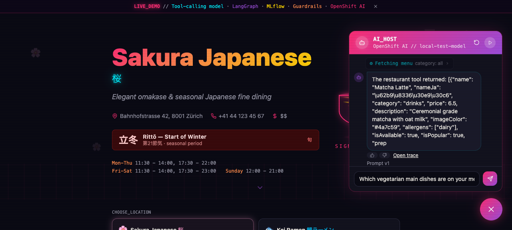
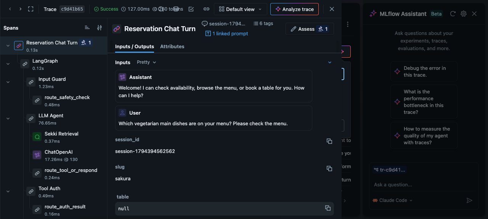

# Guided lab validation

The earlier restaurant rehearsal below was recorded on 2026-11-11.
The revised browser-first workshop and agent notebook have separate checks.

## Agent playground revision — 2026-11-12

The notebook executes its real LangGraph/ChatOpenAI code against deterministic
local model and MCP protocol stubs, with real MLflow 3.17.1 SQLite storage.
Eight regression cases pass and cover nested/manual/automatic tracing, toggling tracing
off without stale IDs, MCP disabled with no discovery/call requests, read-only
tool enforcement, recorded tool failures and model-loop limits. These tests
exercise JSON and multiline SSE MCP responses. The chart suite now has 12
passing checks, including the empty initial policy/connected shield and the
workbench provider-option setting. Helm lint and local documentation links pass. They establish instrumentation
behavior, not real-model quality, gateway compatibility or 50-user capacity.

The new workbench dependencies/image and complete revised attendee journey
still need a cluster rebuild/rehearsal. Existing notebook PVCs retain their old
source. Use the infrastructure runbook's explicit reset/recreate when rolling
this revision out. The earlier comparison artifacts below describe the removed
comparison driver, not a step attendees should run now.

## Earlier restaurant checks

| Check | Result |
|---|---|
| Helm lint and all-flags render | Pass |
| Chart regression suite | 11 tests pass, including all 50 namespace/identity mappings and alias preservation |
| Assistant regression suite | 7 tests pass: per-turn and concurrent prompt resolution, fallback visibility, blocked-turn metadata, trace URL, feedback failure/retry and guard outcome distinctions |
| Backend HTTP regression | Pass: upstream save failure and unreachable assistant both reach the caller |
| Frontend production build and backend TypeScript check | Pass |
| Four container builds and clean Compose start | Pass; restaurant menu request traversed frontend/backend/assistant/MCP with tracing disabled, as the default local profile specifies |
| Real local MLflow integration | Pass with SDK/server 3.17.1: ten stored app traces, two prompt versions, active/baseline aliases, linked prompt lineage, native session metadata, feedback assessment and two comparison-table artifacts |
| Browser walkthrough | Pass: configured model, New chat, prompt version, trace deep link and stored-feedback confirmation; aborted feedback request showed retry and subsequently succeeded |

The local integration used the actual application services and a deterministic
OpenAI-compatible **model stub**. Its answers and token counts are synthetic;
it cannot establish Qwen quality or production latency. The local tracking
server used plain localhost authentication; The separate real-cluster checks below cover OpenShift injection and workspace
authorization; the local stub results remain distinct.

Screenshots from that local test (not Qwen/event-cluster results):





## Repeatable repository checks

Install the assistant's pinned requirements in an isolated Python environment,
plus PyYAML. The existing Helm tests require Helm on PATH.

```bash
npm ci
npm run build -w packages/frontend
npx tsc --noEmit -p packages/backend/tsconfig.json
npx tsx --test packages/backend/test/feedback.test.ts
python -m unittest discover -s packages/mlflow-proxy/tests -v
python -m unittest discover -s charts/tableschnappi/tests -v
python -m unittest discover -s workshop/tests -v
helm lint charts/tableschnappi -f charts/tableschnappi/values-multi-user.yaml
helm template lab charts/tableschnappi \
  -f charts/tableschnappi/values-multi-user.yaml \
  --set garak.enabled=true --set workbench.pipelines.enabled=true \
  --set genaiStudio.enabled=true > /tmp/all-features.yaml
```

The new `mlflow-lab.yml` workflow runs builds/type checking and the regression
suites. Existing project CI remains separate.

## Real event-cluster pilot

The pilot uses `user1` / `tableschnappi-user1`, the real Qwen API,
RHOAI 3.5.2 and operator-managed MLflow 3.14.0. The prepared workbench runs
MLflow SDK 3.17.1 with native `kubernetes-namespaced` authentication.

| Check | Result |
|---|---|
| Single account through the batch command, range `1 1` | Created; repeat preserves its password; other accounts not created |
| Normal participant browser SSO | Pass; MLflow lists only the participant workspace |
| Foreign experiment read through that browser session | `403 PERMISSION_DENIED`; searches filter inaccessible experiments |
| Native workbench integration | Pass; annotation injects connection/auth settings, verified TLS, preinstalled dependencies |
| Workbench browser | Opens through OpenShift auth without a Jupyter token; setup cell prints own workspace and active prompt version |
| Real restaurant comparisons | Five baseline and five candidate cases, two stored comparison artifacts, correct prompt versions/lineage, session metadata, persisted feedback and baseline restore |
| Candidate diagnostic outcome | Requested sections in 4/5 answers; the stock question remains a useful comparison, not a guaranteed formatting success |
| Guardrails | Warmed menu request allowed; coding/homework blocked at Input Guard, with no agent/tool spans and no fail-open |
| Participant policy permissions | Own ConfigMap update and Deployment restart permitted using the participant's RBAC |
| Unused AI asset | Disabled in the profile; application still uses endpoint/model values plus the existing Secret |

The restaurant comparison/guard checks execute in the workbench under its
service account. Browser SSO and direct foreign-experiment denial exercise the
human account separately. They are distinct identities with namespace-local
permissions. The baseline prompt and empty policy are restored for testing.

The same flow subsequently passed after rebuilding on a replacement cluster
with fresh MLflow storage and no restored source history. The source AI/lab
installation was fully removed, including the documented native-controller
finalizer recovery and residual-resource audit; CTFd was preserved. The target
had only the RHOAI operator bootstrapped before replay. Five fresh Git builds
and native YAML/Helm install were exercised; OLM install from zero was not.

## Remaining event gates

- Provision the remaining attendee accounts and deploy their participant stacks
  before scaling the profile to all 50 users.
- Rehearse simultaneous external-model quota/capacity for browser questions,
  guard checks and the independent notebook agents. One agent turn can make
  multiple model calls; quota is shared across the room.
- Rehearse OLM installation from zero on a disposable matching cluster. The
  real move exercised full source uninstall and a target operator-only bootstrap.
- If event history matters, test coordinated database/artifact backup and restore.
